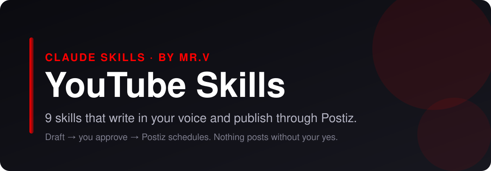

<p align="center">
  
</p>

# YouTube Skills for Claude Code, Claude.ai and Codex

<p align="center">
  
  
  
  
  
</p>

**Claude skills for YouTube.** 9 skills that plan, write, scrub and publish your YouTube content. They draft in your voice, strip the AI tells, and hand finished posts to [Postiz](https://postiz.com) for scheduling, only after you approve. No coding required.

> **On another platform too?** Matching bundles: [LinkedIn](https://github.com/mrvsubstack/linkedin-skills) · [X (Twitter)](https://github.com/mrvsubstack/x-skills) · [Instagram](https://github.com/mrvsubstack/instagram-skills) · [Threads](https://github.com/mrvsubstack/threads-skills) · [Facebook](https://github.com/mrvsubstack/facebook-skills) · [TikTok](https://github.com/mrvsubstack/tiktok-skills) · [Pinterest](https://github.com/mrvsubstack/pinterest-skills) · [Reddit](https://github.com/mrvsubstack/reddit-skills). Same voice rules, same approve-before-publish flow.

> **Want the full library?** These are a free sample of the Mr V Skills library: 240+ skills for writing, newsletters, offers, ads, SEO and research. [Get it on Substack →](https://promptwithjason.substack.com)

## Install

### Claude.ai (web) or Claude Desktop

1. Click **Customize** in the sidebar and open **Plugins**
2. **Add** → **Add marketplace** → **Add from a repository**
3. Paste `mrvsubstack/youtube-skills` and sync
4. Open **Discover**, find **youtube-skills**, click **+** to install
5. Start a new chat and ask for a YouTube post

> Plugins need a paid Claude plan with code execution turned on.

### Claude Code

```
/plugin marketplace add mrvsubstack/youtube-skills
/plugin install youtube-skills@youtube-skills
```

Or clone it and open the folder. The `.claude/skills/` folder points at every skill, so they load with no install:

```bash
git clone https://github.com/mrvsubstack/youtube-skills.git
cd youtube-skills
```

### Any agent (Codex, Cursor and others)

```bash
npx skills add mrvsubstack/youtube-skills
```

Or point your agent at `skills/*/SKILL.md`. Each one is plain markdown.

> **Found this useful? [Star the repo](https://github.com/mrvsubstack/youtube-skills).** It's how the next person finds it.

## What you can do

Ask in plain English. The right skill picks itself.

**Title it:**
> "Give me 10 titles for my video on budgeting with irregular income."

**Hook the first 30s:**
> "Script the first 30 seconds of this video: [outline]"

**Write the description:**
> "Write an SEO description with chapters from this transcript: [paste]"

**Brief the thumbnail:**
> "Thumbnail brief for this title: [title]"

**Ship it:**
> "Upload this video to YouTube as unlisted through Postiz with that title and description."

Every skill shows you a draft first. Nothing goes out until you say yes.

## The 9 skills

| Skill | What it does |
|---|---|
| **Title Optimizer** (`yt-title-optimizer`) | Turns a video topic, a draft title or a finished video into 3 to 5 honest, high-click YouTube titles, each tagged with its formula, character count and job (browse or search), plus a pick for YouTube's Test & Compare. |
| **Thumbnail Brief** (`yt-thumbnail-brief`) | Turns a video idea and its title into a designer-ready thumbnail brief: one focal subject, a face and a named emotion (or the hero object), 4 words of overlay text or fewer that never repeat the title, contrast, composition and a phone-size read test, delivered as 2 to 3 concepts for YouTube's Test & Compare. |
| **Hook Scripter** (`yt-hook-scripter`) | Scripts the spoken opening that decides whether people keep watching: the first 30 seconds of a long-form YouTube video, beat by beat with timestamps, or the first 3 seconds of a Short plus a loop ending. Confirms the title's promise, opens a loop and makes a watch-contract with no greeting and no intro. |
| **Description Writer** (`yt-description-writer`) | Writes a complete YouTube description: a first-150-character hook that works as the search snippet, a short body with the main keywords placed naturally, timestamped chapters, labelled links, one specific call to action and 3 to 5 hashtags, all under the 5,000-character limit. Covers long-form and Shorts. |
| **Content Planner** (`yt-content-planner`) | Builds a YouTube content plan from your niche, audience and capacity: 3 to 5 pillars, a long-form and Shorts mix you can actually hold, and video ideas sorted into search videos (people type them) and browse videos (the feed serves them), each slot pre-paired with a title angle, thumbnail angle, opening shape and goal. |
| **Channel Optimizer** (`yt-channel-optimizer`) | Audits a YouTube channel page and rewrites what's failing: name and @handle, banner (with the mobile and TV safe area), profile picture, description and keywords, the trailer non-subscribers see, the featured video subscribers see, playlists and section order, watermark and links. Returns a 10-part scorecard, ranked fixes and before → after rewrites. |
| **Community Post Writer** (`yt-community-post-writer`) | Writes YouTube community posts (the Posts tab): text updates, polls, image posts and question prompts that keep subscribers warm between uploads, seed comments and set up the next video. Each post has one hook line, one ask and a clear job. Returns copy-paste posts plus a suggested weekly rhythm. |
| **Repurposer** (`yt-repurposer`) | Works both ways around a YouTube video. Out: turns a video or its transcript into Shorts (with timestamps and frame-one hooks), a newsletter issue, a LinkedIn or X post and a community post. In: turns a blog post, newsletter or thread into a video brief (title options, opening script, chapter outline). Keeps the core claim and real numbers, rebuilds the delivery for each platform. |
| **Postiz Publisher** (`yt-postiz-publisher`) | Checks a finished post against YouTube's rules, shows you an approval card, and schedules it through Postiz after you say yes. Saves a copy-ready file when Postiz isn't set up. |

Some skills suggest companion skills from the other platform bundles or from the [full Mr V library](https://promptwithjason.substack.com) (for example `voice-profile-bank` or `final-edit-modes`). They're optional. Without them, each skill still does its whole job.

## Publish with Postiz

By default the skills hand you a copy-ready post. Connect [Postiz](https://postiz.com) and Claude can schedule it for you.

**Why Postiz:** it's open source, you can self-host it for free, and one account covers YouTube plus 25+ other channels. The hosted plan works too.

**Setup (5 minutes):**

1. Create a Postiz account (or self-host it) and connect YouTube under **Add Channel**.
2. Copy your API key from **Settings** → **Public API**.
3. Save it as an environment variable, not in the chat:
   ```bash
   export POSTIZ_API_KEY="your-key"
   # self-hosted only:
   export POSTIZ_API_URL="https://your-domain/api/public/v1"
   ```
4. Restart Claude and ask: **"List my Postiz channels."**

Full guide: [`skills/yt-postiz-publisher/references/postiz-setup.md`](skills/yt-postiz-publisher/references/postiz-setup.md).

**How a post ships:**

1. A writer skill drafts the post.
2. You edit until you like it.
3. `yt-postiz-publisher` checks it against YouTube's limits and shows an approval card: account, local time and UTC, media, exact text.
4. You say yes. It schedules through Postiz and gives you the post id.

No key? It saves the post to `post-ready-to-paste.txt` instead. Nothing breaks.

**Not published through Postiz:** Community tab posts (YouTube's API doesn't publish them). The community post writer hands you a copy-ready block.

## Voice rules every skill follows

1. A number or a statement in line 1. Never open on a question.
2. Odd precision beats round numbers: "$4,730" reads like a receipt, "$5k" like a guess.
3. One real detail per post. If you didn't give one, the skill asks. It never invents one.
4. No stock AI words (leverage, robust, elevate, navigate, foster, delve).
5. No reveal bridges ("Here's the thing", "Plot twist:") and no staccato stacks ("Simple. Fast. Done.").
6. Em dashes capped at about one per 100 words.

## Troubleshooting

| Problem | Fix |
|---|---|
| Skills don't activate | Start a new chat after installing. In Claude Desktop, check the plugin is listed under **Yours**, not only **Discover**. |
| "Postiz isn't connected" | `POSTIZ_API_KEY` isn't visible to Claude. Set it in your shell profile, open a new terminal, restart Claude. |
| 401 from Postiz | The key is wrong or was regenerated. Copy it again from Settings → Public API. |
| 429 from Postiz | You hit Postiz's hourly posting limit. Wait and try again. |
| YouTube channel not found | Connect it in the Postiz dashboard, or reconnect it if it shows as disabled. |
| Validation error on a post | A required platform setting is missing. The publisher reads the error and asks you for it. |

## Credits and license

Several skills here were rewritten in Mr.V's own words from methods in Serge Bulaev's MIT-licensed [youtube-skills](https://github.com/sergebulaev/youtube-skills). See [CREDITS.md](CREDITS.md).

MIT licensed. See [LICENSE](LICENSE). Not affiliated with YouTube or Postiz.

Made by **Mr.V** · [Substack](https://promptwithjason.substack.com)
